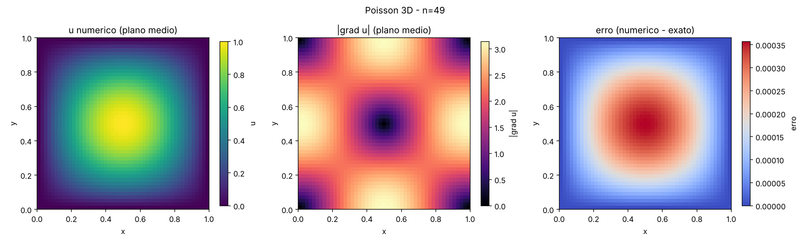
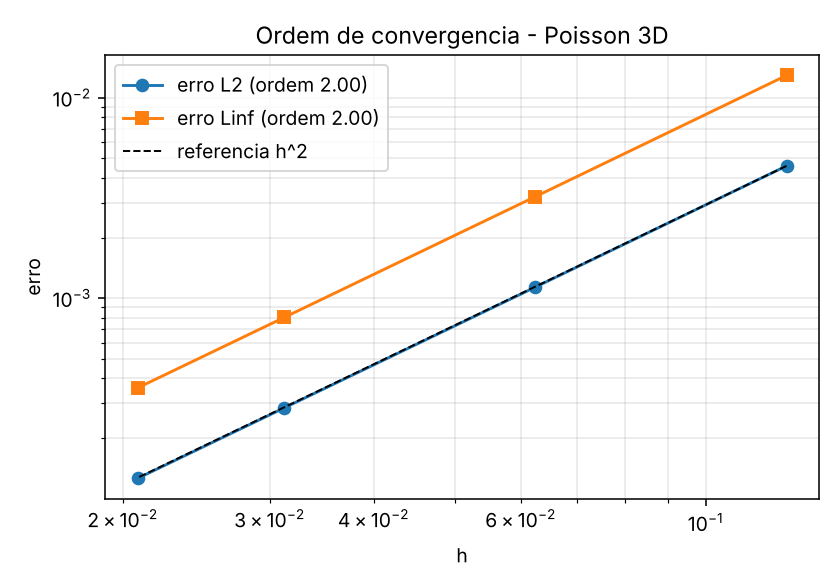
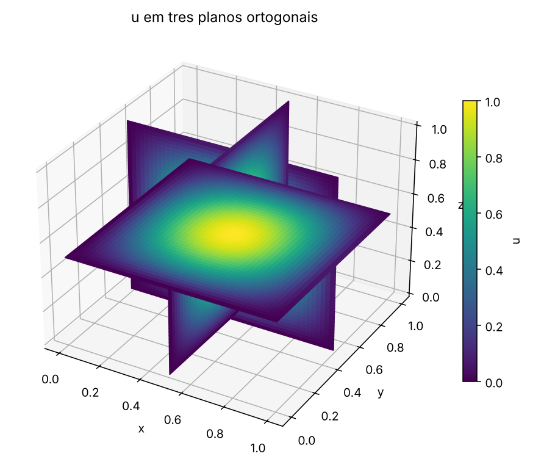
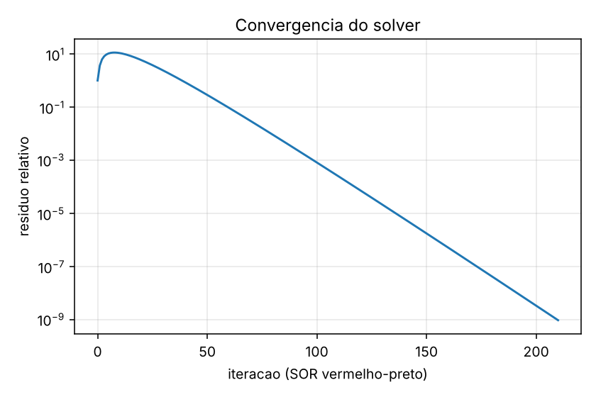
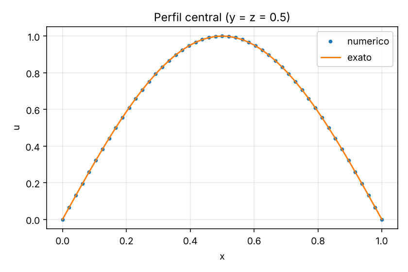
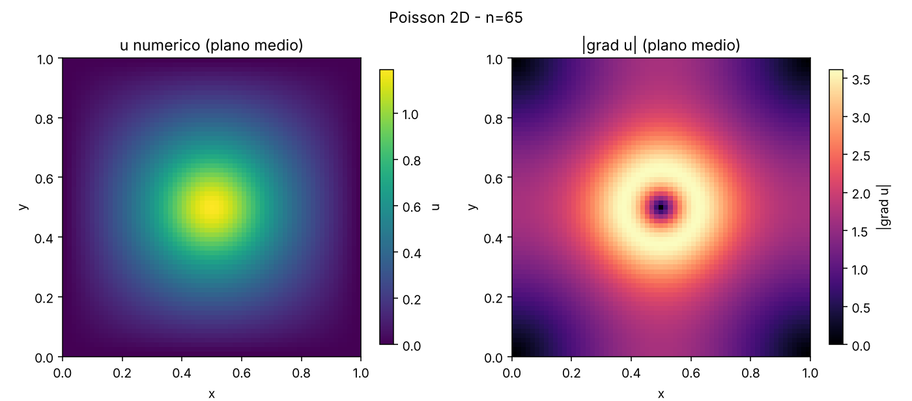

# Poisson + VTK/ParaView: solver, exportação e pós-processamento

Solver da equação de Poisson em **C++** (diferenças finitas, 2D e 3D) que exporta a solução em
formato **VTK** (`.vti` e `.vtk`) para visualização no **ParaView**, mais scripts de
pós-processamento em **Python** que geram as figuras do repositório.

## O problema

Resolve-se

    -Δu = f   em [0,1]^d  (d = 2 ou 3),   u = 0 no contorno

com o esquema de 5 pontos (2D) ou 7 pontos (3D) e o método **SOR vermelho-preto**
(fator ω ótimo teórico por padrão).

Casos disponíveis:

| caso    | descrição                                                | solução exata |
|---------|----------------------------------------------------------|---------------|
| `seno`  | solução manufaturada `u = Π sin(π xᵢ)`, `f = d·π²·u`      | sim (gera o campo de erro) |
| `gauss` | fonte gaussiana no centro do domínio                     | não |

## Estrutura

    src/poisson.cpp                 solver + pós-processamento (erro, gradiente)
    src/vtk_writer.hpp              escritores .vti (XML) e .vtk (legacy), sem dependências
    scripts/posprocessar.py         lê o .vti e gera figuras + relatório (numpy/matplotlib)
    scripts/estudo_convergencia.py  verifica a ordem de precisão (esperado: 2)
    scripts/renderizar_paraview.py  renderizações offscreen no ParaView (pvpython)
    exemplos/                       saídas prontas (3D seno n=25, 2D gauss n=65)
    docs/images/                    capturas e gráficos

## Compilar e executar

Precisa apenas de um compilador C++11 (`g++` ou `clang++`).

    make
    ./poisson --dim 3 --n 49 --caso seno --saida saida

Opções: `--n`, `--dim`, `--caso`, `--tol`, `--maxit`, `--omega`, `--saida`, `--formato vti|vtk|ambos`
(veja `./poisson --help`). A pasta de saída é criada automaticamente. Cada execução grava:

- `solucao.vti` e/ou `solucao.vtk` com os campos `u_numerico`, `f`, `u_exato`, `erro` e `grad_u` (vetor)
- `convergencia.csv` (resíduo por iteração) e `resumo.txt`

> Os arquivos são ASCII (fáceis de inspecionar). Para malhas grandes, prefira `--formato vti`
> e reduza `--n`.

## Visualizar

### Opção A: ParaView (GUI)
1. `File > Open` → `saida/solucao.vti` → **Apply**.
2. Colorir por `u_numerico`; use **Slice**, **Contour** (isosuperfícies) e **Glyph** (campo `grad_u`).
3. `File > Save Screenshot` para gerar as imagens do repositório.

### Opção B: ParaView por script (sem GUI)

    pvpython --force-offscreen-rendering scripts/renderizar_paraview.py saida/solucao.vti docs/images

Gera `pv_fatia.png`, `pv_isosuperficies.png`, `pv_tres_planos.png`, `pv_gradiente.png` e `pv_erro.png`.

### Opção C: sem instalar o ParaView

    pip install numpy matplotlib
    python3 scripts/posprocessar.py saida/solucao.vti --destino docs/images

Gera fatias, perfil central, convergência, vista 3D e `relatorio.txt`. Também roda no Google Colab.
Para ver os arquivos `.vti` no navegador, existe o ParaView Glance (web), mas confira a
compatibilidade com o seu navegador.

## Verificação

Ordem de precisão medida em 3D (`scripts/estudo_convergencia.py`, malhas 9, 17, 33, 49):
**ordem 2,00** nas normas L2 e L∞, como esperado para diferenças finitas centradas.

Os arquivos `.vti` e `.vtk` gerados foram lidos com a biblioteca oficial VTK (Python) para checar
dimensões, espaçamento e nomes dos campos.

## Resultados

| | |
|---|---|
|  |  |
|  |  |

## Para evoluir

- Substituir o SOR por gradiente conjugado com pré-condicionador multigrid
- Exportar em binário/`appended` para reduzir o tamanho dos arquivos
- Séries temporais (`.pvd`) para equação do calor
- Contorno de Neumann e domínios com obstáculos
- Substituir `docs/images/pv_*.png` pelas capturas feitas no ParaView

## Licença

MIT (ajuste conforme preferir).
